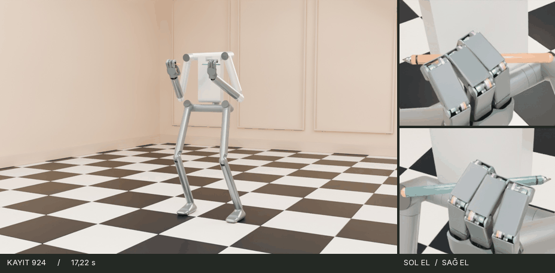

# İtme altında iki kalemle yürüyüş

Bir insansı robot, iki kalemi parmak uçlarında hareket ettirirken beklenmedik bir yanal itmeden sonra nereye basar? Bu proje, aynı fizik simülasyonunda ayak basışını, ileri yürüyüşe dönüşü ve kalemlerin ele göre hareketini ölçüyor.

**Bimanual Fingertip Manipulation During Humanoid Push Recovery**  
Ali Özkurt · 17 Kasım 2026

**[İngilizce makaleyi oku · PDF](makale/Makale.pdf)　 ·　 [Filmi aç · 1080p / 60 fps](medya/Film.mp4)　 ·　 [15 koşunun sonuçları](veri/Deney-ve-olcumler.md)**

*İkinci itmenin ilk dört saniyesi. Sağ üstte sol el, sağ altta sağ el gösteriliyor. Bu kesite tıklayarak 55 saniyelik özgün MP4 dosyasını açabilirsiniz.*

| Filmdeki en güçlü itme | İtme yönünde adım | İki kalemin kendi eline göre hareketi |
|:---|:---|:---|
| **107,7 N** · tepe yükünde 1,82 s | **29,4 cm** · havadan yere yeni basış | **33,9° / 33,9°** · sol / sağ |

## Filmi ölçümleriyle izle

Depoyu bilgisayarınıza indirdikten sonra kökteki [index.html](index.html) dosyasını tarayıcınızda açın. Beş itmeden birini seçtiğinizde oynatıcı ilgili ana gider. Bütün kamera açıları aynı kesintisiz hareket kaydına bağlıdır. Kuvvet, temas, adım ve kalem ölçümlerini yan yana inceleyebilirsiniz. [Tam itme anındaki yakın çekimler](medya/Itme-aninda-iki-el.jpg)

## Çalışma yöntemi

1. **Dış kuvvet üretimi.** Simülatör robotun beline sağdan veya soldan yük uygular. Yeni takvimlerde kuvvetin başlangıcı, yönü, şiddeti ve süresi değişir. Denetleyici yükü ancak gerçekleşen hareketten kestirir.
2. **Denge adımı.** Denetleyici mevcut durumu kopyalar ve olası basışları ileri simülasyonla karşılaştırır. Ayaklar hem çok açık hem öne arkaya kaymışsa önce yana basıp açıklığı daraltır, sonra ileri yürüyüşe döner.
3. **Kalem hareketi.** İki serbest kalemin her birini V3 elinin tendon hareketi yönlendirir. Kalem kaydığında ilgili elin hareket genliği azalır. Kalem açısını parmaklarla aynı yönde dönen bileğe göre ölçeriz.
4. **Eşlenmiş karşılaştırma.** Filmdeki her itme için başlangıç durumunu ve önceki itmeleri koruyarak bir koşu daha yürüttük. Seçili itmenin kuvvetini kaldırınca belin konumunun nasıl değiştiğini 500 Hz kayıttan ölçtük. En yüksek yükteki ikinci itmede, yük platosunun sonundaki fark itme yönünde 40,0 cm oldu.

## Sonuçlar

| Koşu grubu | Tüm ölçütleri karşılayan | Eksik kalan kayıtlar |
|:---|:---:|:---|
| Önceki zamanlamalar | 4 / 4 | — |
| Film ve ek denemeler | 3 / 5 | 1042, 1052 |
| Denetleyici sabitlendikten sonra ayrılan zamanlamalar | **5 / 6** | 1071 |
| **Toplam** | **12 / 15** | **3 kayıt** |

Başarı, 55 saniye boyunca ayak dışında yere değmeden beş itmenin **her birinde** en az 3 cm yanal adım ve ardından en az 2 cm ileri yürüyüş gerektirdi. Her iki elde karşılıklı parmak ucu teması örneklerin en az %98’ini kapsamalı, avuç teması olmamalı ve her kalem her itmede kendi eline göre en az 15° hareket etmeliydi. Başarısız koşular denge izleme sınırına ulaştığında durduruldu. Deney 60–115 N aralığında yanal itmelerle, tek model üzerinde ve yerel Ubuntu bilgisayarında yürütüldü. [Koşu bazında ölçümler](veri/Deney-ve-olcumler.md) · [Ham ölçümlerin özeti · JSON](veri/Olcumler.json)

Aynı 15 itme takvimiyle tekrarlanan ikinci deneyde, yürüyüşe dönüşte önce yana basma kuralını kapattık. Birleşik başarı 12/15’ten 11/15’e indi. Altı yeni takvimde iki koşul da 5/6 verdi. 714 numaralı kayıtta her iki robot da 55 saniyeyi tamamladı, ancak kural kapatıldığında beşinci adım itmenin ters yönüne düştü. [Eşlenmiş deney verileri ve tek değişiklik](supplement/stance-ablation/REPRODUCE.md) · [Tek tek itmelere ait ölçümler](supplement/event-audit/README.md)

## Makaleler ve proje dosyaları

- **Bu çalışma.** Deney düzeneği, yöntem, karşılaştırmalı sonuçlar, başarısız koşular ve sınırlılıklar. [İngilizce makale · PDF](makale/Makale.pdf)
- **Ma ve ark.** Eureka’nın kalem döndüren el deneyi, parmak ucunda kalem hareketi görevimizin çıkış noktasıydı. Buradaki yürüyüş, durumu gözleyip aday basışları simüle eden bir denetleyiciyle üretildi. [Eureka: Human-Level Reward Design via Coding Large Language Models](https://eureka-research.github.io/)
- **Qi ve ark.** Farklı nesneleri el içinde döndürme ve hareketi fiziksel ele aktarma üzerine karşılaştırmalı bir çalışma. [In-Hand Object Rotation via Rapid Motor Adaptation](https://proceedings.mlr.press/v205/qi23a.html)
- **Pratt ve ark.** Yanal bozucu kuvvetin ardından atılacak denge adımının konumunu açıklayan *capture point* yaklaşımı. [Capture Point: A Step toward Humanoid Push Recovery](https://doi.org/10.1109/ICHR.2006.321385)
- **Güncel robot öğrenmesi çalışmaları.** π0.5, farklı veri kaynaklarıyla eğitilmiş bir görme–dil–eylem modeliyle ev içi manipülasyonu inceler. DreamZero, video ve robot eylemlerini birlikte tahmin eden bir dünya–eylem modelidir. Bu iki çalışmanın özgün makaleleri akademik sunum için incelendi. [π0.5 · CoRL 2025](https://proceedings.mlr.press/v305/black25a.html) · [DreamZero · PDF](https://dreamzero0.github.io/DreamZero.pdf)
- **Proje dosyaları.** [Tam arşiv ve geri yükleme](arsiv/README.md) · [Proje ve yayın planı](docs/Proje-plani.md)

Hazır film koşusunu yerel bir Ubuntu kurulumunda üretmek için [yeniden çalıştırma adımlarını](docs/Yeniden-calistirma.md) izleyin. Bu depodaki taşınabilir model ile 924 numaralı kayıt yeniden çalıştırıldı. Pozlar, eklem durumları, temaslar ve her iki kalemin tüm örnekleri film kaydıyla birebir eşleşti.
